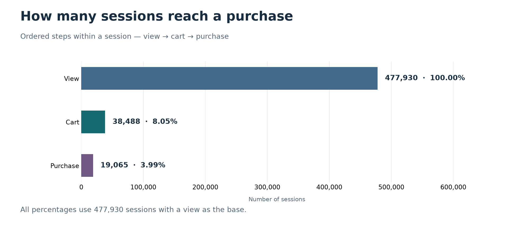
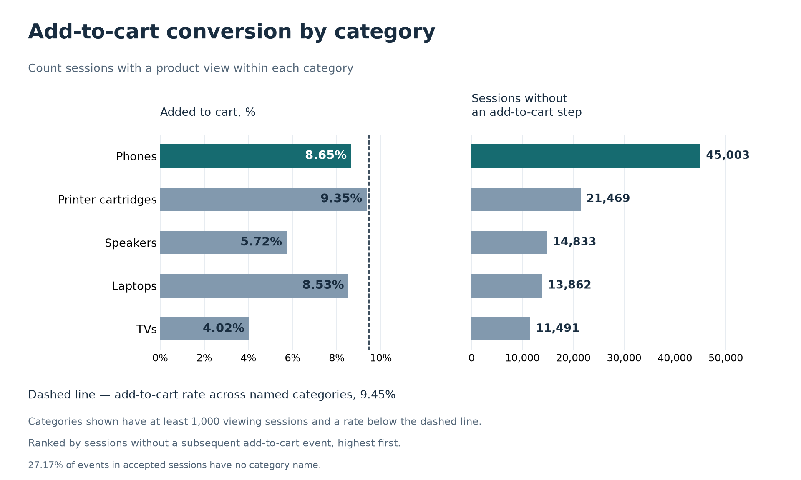

# Clickstream — e-commerce event pipeline

[Русская версия](https://github.com/YaraBykova/ecommerce-clickstream-pipeline)

## Project goal

Keep the **view → cart → purchase** funnel correct when data arrives in batches,
files are delivered again, and events arrive late.

The analytical question is **where does the path to purchase break off,
and which product categories deserve a closer look?**

**Stack — Python, PostgreSQL, SQL, Docker Compose, Matplotlib.**

## How many sessions reach a purchase

Of sessions with a product view, **8.05%** reach the cart and **3.99%** complete
the sequence through to purchase. The largest drop is between viewing and
adding to cart, so the category comparison focuses on this step.

A session represents a visit to the store. A visit with a view, an add-to-cart
event and a purchase in that order contributes to all three bars. Every percentage
in the chart uses sessions with a view as its denominator.

## Add-to-cart conversion by category

The comparison covers **107 categories with a recorded name**. Across these
categories, **9.45%** of session–category pairs with a view reach the cart.
The chart shows five categories selected using the rules below.

Under this selection rule, **phones** come first for further review.
Of 49,264 sessions viewing this category, 4,261 include a subsequent add-to-cart
event, a rate of **8.65%**. The remaining 45,003 sessions have no such transition.

The next action is to check the category's product mix and the completeness of
cart-event tracking. Explaining the differences requires additional product
and store-operation data.

## Methodology

1. Use the source's session IDs. Accept sessions with a nonempty ID, exactly
   one user and a duration of up to 24 hours, inclusive.
2. Within each session, find the first view, then the first cart event and
   purchase in that order. Each event must be strictly later than the previous
   step. Count a session once at each stage.
3. Use **477,930 sessions with a view** as the base for the overall funnel chart.
4. Group categories by their nonempty name. For each session–category pair
   with a view, check for a later cart event in that category. One session can
   contribute to several categories.
5. Select categories with at least **1,000 viewing sessions** and an add-to-cart
   rate below **9.45%**. Rank them by sessions without a subsequent cart event.

The 1,000-session threshold focuses the review on larger groups. This selection
provides a direction for investigation. Statistical significance was not assessed.

Detailed rules, tables and worked examples are in the
[methodology](docs/methodology.md).

## Data and limitations

The source contains **885,129 store events** from 24 September 2020 to
28 February 2021. Session filtering retains **806,078 events**.
[Dataset on Kaggle](https://www.kaggle.com/datasets/mkechinov/ecommerce-events-history-in-electronics-store).

- **27.17%** of retained events have no category name. They remain in the overall
  funnel. The category comparison covers the named portion of the data.
- Products may differ between funnel steps.
- The overall funnel counts sessions, while the category comparison counts
  session–category pairs. Their denominators differ.
- The causes of conversion differences require a separate investigation.

## How the pipeline works

CSV and ZIP files follow **Python → PostgreSQL → analytical views → charts**.
Source events are stored in `raw`, accepted sessions and related entities in
`core`, and analytical calculations in `mart`.

The loader registers each batch. Redelivery adds zero rows, and late events
trigger a refresh of affected sessions. A failure rolls back the load and its
related database changes.

A delivery is identified by its batch ID and record number. Deduplicating
overlaps between different batches requires a source event ID.

## Validation

| Check | Result |
|---|---|
| Full archive loaded in batches | 885,129 events, 9 batches |
| All batches delivered again | 0 new rows |
| Comparison with a full rebuild | 0 differences across 9 tables and views |
| PostgreSQL integration tests | 21 passed |

The full run and tested cases are described in the
[batch and late-event validation report](reports/batch-processing.md).

## Reproduce the results

Data preparation, PostgreSQL configuration, loading commands, chart generation
and test commands are in the [setup guide](docs/setup.md).
